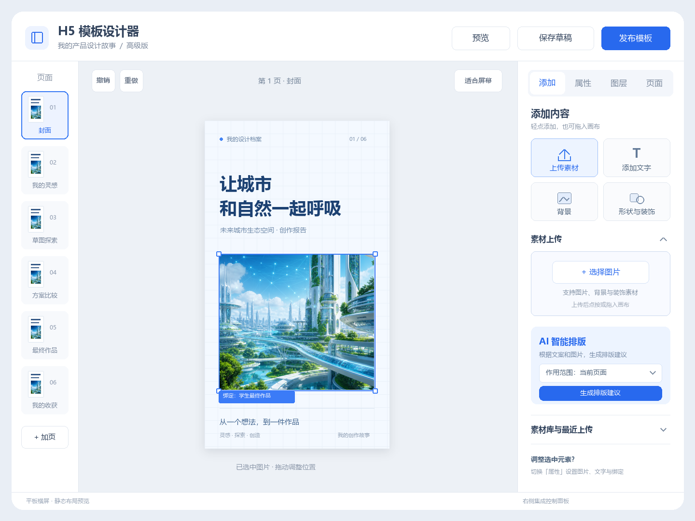

# H5 报告后台模板设计方案：1号方案（已确认，代码已落地）

日期：2026-10-16。版本：1.2。状态：用户已明确回复“执行”，代码已落地，本地验证通过；设备、真实多页效果与部署待验收。

本文保留已确认方案与验收要求。实际实现和验证以实施验收记录为准，未通过的项目不视为完成。

## 一、已确认的核心方案

采用已选定的平板横屏布局：左侧管理页面，中间预览和编辑，右侧集成“添加、属性、图层、页面”四个面板。取消底部工具栏。

后台管理员基于内置版式制作模板；学生已有创作记录自动归集，沿用现有 AI 内容整理，再按所选模板自动排版。学生不需要重新输入整篇文案、上传已有作品或编辑模板。

“1号方案”是本次编辑器界面方案的名称。拟沿用标准 H5 生成策略 `h5-standard`，不等同于新增一个生成策略，也不启用测试中的无限画布工作流。

### 确认摘要

| 决定项 | 本方案建议采用的方案 |
| --- | --- |
| 首期使用者 | 管理员编辑模板，高级版学生先使用，其他版本按现有授权管理 |
| 编辑器范围 | 支持文字、图片、背景、装饰的图层编辑和拖动缩放，基于内置版式工作 |
| 内容来源 | 自动归集学生已保存且已接入的项目资料，复用现有 AI 整理结果 |
| 自动排版 | AI 在模板规则内决定页面和元素布局，生成可保存、可复现的结构化结果 |
| 首套效果 | 完成一套蓝白创意手账模板，包含八类章节及素材多少不同时的组合 |
| 首期交付边界 | 编辑器、模板、AI 排版、学生生成、保存审核、分享和旧报告兼容全部验收 |
| 后续增强 | 任意参考图自动分析、AI 生成人物或装饰、批量生成和复杂动画另行安排 |

用户确认的是以上功能范围及本文验收要求。普通实现细节由开发过程判断；若出现必须扩大数据采集范围、迁移持久化数据、增加付费服务或明显增加工作量的情况，先说明实际差异，再确认该项变更。

## 二、现状与实施边界

本轮只核对代码、当前本地配置和既有记录，没有重新验证线上或真实运行行为。

| 现有基础 | 本方案的处理 |
| --- | --- |
| H5 中心已有生成方案、版本与模板、视觉风格、文案与智能体、审核与发布 | 沿用原入口和配置，重点升级“视觉风格”编辑体验 |
| 高级版 `pro` 当前允许标准 H5，学生可选模板 | 第一轮验收以高级版为主；其他版本授权维持原配置 |
| 生成页已有项目资料汇总与 `/report/generate` 内容整理调用 | 复用已有内容整理，接入后续排版，不重复建设整理入口 |
| 四套基础风格之外，代码中已有产品设计故事模板 | 保留现有模板及其标识，优先完善产品设计故事的手账效果 |
| 草稿、发布配置、报告审核与模板快照已有基础 | 扩展现有存储和流程，不建立第二套模板库 |
| 无限画布报告策略当前为测试状态，未绑定可执行工作流 | 本方案不依赖它，也不改变它的状态 |
| 已有报告编辑代码包含拖动与缩放处理 | 实施时评估复用交互逻辑，不直接把 PPT 数据结构套到 H5 |

项目既有决策采用固定 H5 版式，明确不优先开发完整自由编辑器。本方案拟扩展为“限定元素、限定页面内的可视化模板编辑”：允许文字、图片框和装饰的拖动缩放，保留基础版式与自动适配规则。此方向变化将在用户确认后、功能实施前写入技术决策记录；本草案不覆盖既有决策。

本轮范围不包含通用 PPT 编辑器、任意网页组件、无限画布节点编辑、复杂动画、多管理员实时协作、学生自由编辑模板，也不承诺任意截图一键无损还原。

## 三、后台操作设计

### 1. 入口与模板列表

进入“H5 报告中心 → 视觉风格”，从现有模板列表打开1号编辑器。支持新建、复制、编辑、保存草稿、预览、发布和停用；内置模板优先复制后修改。列表显示所属版本、所属生成策略、发布状态和更新时间。

版本授权继续在“版本与模板”维护。发布模板不自动向所有学生版本开放。

### 2. 编辑器区域

| 区域 | 功能与行为 |
| --- | --- |
| 顶部 | 模板名称、保存状态、预览、保存草稿、发布；发布前显示变更范围 |
| 左侧页面栏 | 缩略图、当前页、增加页面、复制、排序、删除；排序同时提供点按按钮 |
| 中央画布 | 以9:16竖版报告为主要编辑对象，适合屏幕、缩放、撤销、重做、拖动、缩放、对齐吸附 |
| 右侧“添加” | 上传图片、添加文字、背景、形状与装饰、素材库、AI 排版；次要功能折叠展示 |
| 右侧“属性” | 根据选中对象展示内容绑定、字体、颜色、对齐、图片适应或裁切、尺寸、位置、旋转、透明度与锁定 |
| 右侧“图层” | 命名、选中、显示或隐藏、锁定、前移后移、复制和删除 |
| 右侧“页面” | 章节类型、基础版式、背景、页边距、内容密度、素材不足和文字过长时的处理规则 |

常用触摸目标至少44像素，支持点按添加和按钮调序，拖拽不是唯一操作方式。侧栏独立滚动，切换标签不清空编辑状态。横屏重点检查1024×768、1280×800与常用桌面尺寸；竖屏可浏览和预览，复杂排版提示横屏，离开前仍能保存草稿。

发布操作复用现有配置发布能力。编辑器“发布模板”只发布当前模板，并由服务端合并到已发布配置，其他模板草稿和版本授权不随之发布；原有“发布配置”仍在 H5 中心使用，并显示整份变更清单。两种动作都检查配置版本，发生冲突时保留本地编辑并提示重新载入或另存，不静默覆盖。

### 3. 首期功能的具体规则

| 功能 | 首期规则 |
| --- | --- |
| 添加文字 | 提供标题、正文、注释三类文本块；字体、字号、行距、颜色、对齐按文本块设置 |
| 添加图片 | 可选择固定模板图片或绑定学生图片；保留原始比例，支持适应、填满、裁切与圆角 |
| 背景与装饰 | 提供单色、图片背景，以及内置纸张、便签、胶带等资源；支持大小、旋转、透明度和层级 |
| 选择与拖动 | 单元素点选，拖动只在本页生效；支持拖拽手柄和右侧位置、大小设置；显示对齐线 |
| 锁定 | 锁定位置与大小，阻止拖动及 AI 重排；动态内容仍可随学生替换；内容过长时提示，不突破锁定范围 |
| 撤销与重做 | 一次拖动、裁切、文字修改或 AI 应用作为一项记录；首期支持当前编辑会话，不承诺跨设备撤销 |
| 页面操作 | 新建页面先选章节与版式；复制生成独立页面标识；删除页面需确认，删除后可撤销 |
| 保存 | 编辑完成并停止操作后短暂延迟自动保存服务端草稿；明确显示未保存、保存中、已保存、失败；手动保存立即执行 |
| 失败保护 | 保存失败仍保留当前画布，允许重试，离开时提示；服务端成功回执前不显示“已保存” |
| 预览 | 使用当前草稿和选定样例生成预览，不发布、不改变学生报告；普通预览不产生 AI 费用 |
| 素材清理 | 被已发布模板或历史报告引用的素材不可直接永久删除；首期采用停用或从素材库隐藏 |

上传优先复用现有持久化资产接口。首期接收 PNG、JPEG、WebP；文件扩展名与真实类型都校验，不直接执行上传的 SVG、HTML 或脚本。建议单图上限10MB，若现有服务限制更严则遵守已有上限，并在按钮附近展示实际限制；大图生成预览尺寸，保留原始作品。新字体首期从预置授权中文字体中选择，不开放任意字体上传。

### 4. 完整状态说明

- 没有模板：展示“基于内置版式创建”，进入可编辑草稿，不自动发布。
- 没有素材：展示明确的上传或绑定入口；样例占位图只用于编辑器，禁止进入正式报告。
- 没选元素：右侧“属性”提示选择对象，保留“添加”和“页面”入口。
- 素材上传中或失败：显示状态与重试，正式发布前检查必需资源是否已经上传成功。
- 数据读取失败：提示重新加载；不得把本地缓存标成当前服务器的正式发布内容。
- 模板停用：新生成不可选择；历史报告继续读取自己的快照。重新启用需通过原版本授权。

### 5. 内容绑定

| 元素类型 | 内容来源 |
| --- | --- |
| 动态文字 | 项目名称、创意想法、设计问题、修改说明、选择理由、创作收获等已整理内容 |
| 动态图片 | 当前项目的原始草图、优化草图、参考素材、生成版本、最终作品、已有3D预览或视频封面 |
| 固定素材 | 模板背景、纸张、胶带、人物贴纸和装饰等可复用资源 |

后台用授权范围内的样例项目或明确标注的示例数据预览。样例学生内容不得随模板发布；发布的是内容绑定规则和模板资源。学生真实内容只在生成自己的报告时填入。

每个绑定显示来源名称与预览值。例如，“最终作品”跟随学生已确认的最终作品标识，“修改前后”按真实版本关系排列。没有确认最终作品时，可继续检查资料，但正式生成前提醒确认。未记录修改原因时只描述可确认的变化，不编造学生选择理由或日期。

### 6. 首期自动归集的范围

| 来源 | 首期读取内容 | 明确边界 |
| --- | --- | --- |
| 当前项目及课程记录 | 已保存的课程回答、创意文字、提示词和项目说明 | 只取当前项目关联的记录，不扫描学生其他项目 |
| 草图与绘画成果 | 原始草图、优化草图、已有生成版本、最终作品 | 版本关系使用真实记录，不能把界面排序当作完整创作历史 |
| 3D与视频成果 | 已关联项目的预览、封面和已有文字说明 | 首期不新增模型渲染、视频转写或视频内容分析 |
| 无限画布 | 已保存并能明确关联到当前项目的产出 | 不推测未记录的节点历史；把全部画布历史接入报告属于后续独立评估项 |

实施阶段1必须交付“已接入、缺失、无法判断”的来源清单。某类来源目前无法关联时，报告显示缺失提示或按模板规则省略，不要求学生重复录入已有资料来掩盖接入缺口；需补接的实际范围纳入实施说明。

## 四、学生端与 AI 排版流程

学生路径：进入 H5 报告 → 整理并确认当前项目资料 → 选择模板 → 生成预览 → 保存并按原规则提交审核 → 审核发布后分享。已有资料自动读取，只在最终作品未确定或素材来源不明确时提醒确认。

内容整理与视觉排版逻辑分开，但复用原生成入口：

1. 从当前用户有权访问的项目中，形成带来源标识的素材清单；区分草图、版本、最终作品、参考图及演示配图。
2. 复用现有 AI 整理结果；若资料没有变化，不因换模板重复整理内容。仅有图片但没有设计理由时，不能把 AI 推测写成学生已经说过的话。
3. 排版 AI 读取已整理章节、可用素材、图片尺寸、模板规则和锁定项，生成页面分配、版式选择与元素位置建议。
4. 服务端验证输出结构、素材权限和模板范围；渲染端测量中文文本，检查越界、裁切及遮挡。装饰之间允许预定叠放，正文和作品重点区域需要保护。
5. 用统一渲染能力生成预览；保存模板版本、内容及最终布局快照，正式报告直接读取快照，不重新随机排版。

后台“AI 排版”支持当前页或整份报告。管理员先看候选结果，再应用；取消不改变原稿，应用后可撤销，锁定元素不会被移动。学生生成时自动完成排版，不显示专业编辑面板。

### 右侧 AI 排版面板

面板依次提供：样例项目、当前页或整份报告、疏朗或标准或紧凑的内容密度、简短排版要求、生成建议、预览、应用。排版要求示例为“作品图更大、装饰少一点”，不能绕过模板约束或修改学生事实。

一次只生成一份候选方案。候选方案使用生成时的草稿版本；若管理员在等待期间修改了画布，结果返回后提示内容已变化，不直接覆盖。锁定内容、固定页眉及必须保留的元素由程序保护，不依靠提示词自觉遵守。

### 输入、输出与重新生成

| 项目 | 规定 |
| --- | --- |
| AI 输入 | 已整理章节、允许使用的素材标识和尺寸、模板可用版式、页面规则、锁定元素、排版要求 |
| AI 输出 | 页面顺序、版式标识、元素标识、文字或素材绑定、位置大小、允许的样式与需要提醒的问题 |
| 输出边界 | 仅接受已定义结构，不接受可执行脚本、任意 HTML、未经验证的图片网址和其他用户资源 |
| 事实保护 | 排版调用主要处理显示方式；需要进一步缩写时保留原文，不能删除必要事实或编造内容 |
| 项目变化 | 资料变化使内容整理及排版结果过期；只换模板则优先复用整理结果，重新排版 |
| 已保存报告 | 打开时不重新整理或排版；用户主动重新生成时产生新草稿，旧正式报告保留 |
| 页面分页 | 先调整版式与间距，再选择更合适的图片组合或增加页面；不无限缩小字号、截断正文或重复图片凑页 |

后台预览不得借用学生账号权限；服务端只提供当前管理员授权范围内的样例。学生运行时素材由服务端根据项目归属解析，前端传来的素材标识不能直接被信任。

### 参考图如何使用

参考图用于管理员定义色彩、纸张、构图与装饰方向，不作为学生创作内容。手账模板做好后，学生不必重复上传参考图。

初版先根据已提供截图制作一套可复用的手账资源和页面组合。后续“上传参考图并由 AI 分析风格”需要支持识图的模型；未配置时明确显示不可用原因，不假装已经分析。无需把每位学生的全部历史图片交给模型。

### 模型、失败与成本

- 内容整理和排版通过现有服务端模型配置调用，前端不持有密钥。新增排版调用按一次用户操作发起一次请求；切换面板、拖动或普通预览不调用 AI。
- 项目内容未变时复用整理结果；排版缓存按用户、项目资料版本、模板版本和约束隔离。重复点击防重，正在生成时显示进度并允许取消。
- 超时、限流、余额不足、空结果及结构错误均显示真实原因。只做有限的程序校正，不循环付费重试；失败时保留原稿，可明确选择基础版式继续。
- 基础报告优先复用已备好的背景和装饰，不为每一页重新生成图片。背景生成属于独立可选操作，费用与等待时间单独提示。
- 具体模型、单次费用和实测速度尚未验证；有可用配置后以一次受控真实调用建立依据，再设置超时、并发和额度，不能提前承诺“几秒生成”或固定价格。

初始建议值为每个用户同时运行1个报告生成任务，排版请求超时60秒，自动付费重试0次。以上是待验证的配置起点，并非速度承诺；沿用供应商或平台更严格的限制。取消优先终止本地任务和可中止的上游请求；若供应商已经计费，界面说明取消不保证退费。重复提交复用任务标识，报告保存也要防止生成多份重复记录。

| 异常 | 用户看到的处理 |
| --- | --- |
| AI 未配置或余额不足 | 说明不可用原因；保留内容，提供基础版式预览，不标为 AI 排版成功 |
| 超时、限流或供应商失败 | 结束等待，显示可重试提示；不后台无限重复调用 |
| 输出结构错误或引用不存在的素材 | 拒绝应用；保留旧结果，允许重新生成或使用基础版式 |
| 排版后仍有文字溢出或重要内容遮挡 | 阻止发布问题模板或提交问题报告，并定位到对应页面 |
| 某个媒体资源读取失败 | 指出缺失素材；可选素材按模板规则跳过，必需素材需要修复后继续 |
| 保存失败 | 保留已生成预览，单独重试保存，不重新调用模型 |

## 五、第一套目标效果

以“蓝白创意手账”作为首套完整验收模板，参考现有产品设计故事的八个章节：封面、灵感观察、发现问题、草图探索、AI 方案比较、立体作品、应用场景、创作收获。

实现蓝白网格、纸张卡片、手写风标题、便签、胶带、人物贴纸、大图与细节图搭配。中文由网页准确渲染；作品保持原图，图片裁切可调整。模板资源需要原创或具有使用授权，不直接复制参考图内的人物与装饰。

同一章节准备单图、双图或多图等适配组合。页面数量随有效内容调整：缺少3D或应用场景时跳过或换用适合的章节；不通过重复图片、缩小到难以阅读的字号或编造过程凑页数。

3D首次以已有预览图展示，不自动产生新的三维角度。缺失人物姿势、透明底作品和装饰资源时，需要单独准备，不能把排版能力当成这些素材已经存在。

目标是风格一致、内容准确且可复用的手账报告，不承诺每份报告都与参考截图逐像素一致。

### 首套模板逐页内容

| 章节 | 优先采用的素材 | 页面组成与缺失处理 |
| --- | --- | --- |
| 这是我的设计 | 标题、已确认最终作品、简短介绍 | 标题加作品主图；没有最终作品时先提醒确认，避免把参考图作为成品 |
| 我的灵感从哪里来 | 已保存参考图、课程回答、灵感文字 | 观察拼贴加便签；没有参考图时使用文字观察卡片 |
| 我想解决的问题 | 问题描述、目标人群、真实场景素材 | 问题与目标卡片；只有文字也可以成页 |
| 我画下第一版想法 | 原始草图、修改草图、相关描述 | 单幅大草图或前后对照；没有草图则省略此章 |
| 我和 AI 一起试方案 | 真实生成版本、已有修改记录、最终选择 | 并列方案对比；只有一个版本时改为单方案展示，不伪造比较 |
| 我把它做成立体的 | 已有3D预览、已有细节图和说明 | 作品主图加细节卡片；没有3D成果则省略 |
| 我想象它真正被使用 | 学生已有场景图或应用设想 | 场景图加说明；只有设想时明确作为设想文字，不生成“真实使用记录” |
| 这是我的收获 | 已有反思、最终作品、可核对的过程节点 | 简洁回顾与收获；没有反思时提示可补充，不虚构心得 |

章节是可选结构，不强制八页齐全。最终页码在布局完成后统一计算。文字内容遵循真实性和阅读完整性，模板中的“内容密度”仅影响呈现，不代表允许删除关键内容。

模板采用统一9:16设计坐标，建议以1080×1920作为内部设计尺寸，画布缩放不改变保存的元素位置。手机预览以390像素宽视口检查阅读效果，正文建议不低于14像素、注释不低于12像素；不满足时调整内容与分页，不用无下限缩小字号来通过验收。

## 六、主要难点、处理办法与验收证据

| 难点或问题 | 处理办法 | 验收时必须看到 |
| --- | --- | --- |
| 所有创作记录未必已经接入报告，画布节点也未必带完整时间线 | 先列出来源覆盖清单；只使用确认接入的记录；记录缺失时提示 | 样例项目逐项对应原始记录，明确未覆盖来源 |
| 图片和文案匹配错，把参考图当成最终作品 | 使用角色、来源和作品标识绑定；歧义时让学生确认，不凭文件顺序猜 | 更换最终作品后，对应页面同步正确，参考图身份保持不变 |
| 预览中的示例图片混入正式报告 | 区分模板预览素材与学生素材；正式生成校验所有动态素材来源 | 缺图项目不会生成其他人的示例作品 |
| 内容过长、图片过多、关键部位被裁掉 | 实际测量文字，调整版式或分页；提供适应与裁切规则 | 长标题、长正文、横图、竖图、少图和多图样例均可读 |
| AI 移动锁定项、输出越界或无效素材 | 校验限定结构与权限；保留锁定项；失败不覆盖原稿 | 无效输出被拒绝且原稿可恢复 |
| 预览与正式报告不同 | 共享布局数据和渲染逻辑；保存最终排版，禁止打开时重新生成 | 同一报告后台、学生预览和手机分享页的内容及层级一致 |
| 字体缺字、手机换行变化、字体加载慢 | 使用可授权且覆盖中文的字体，等待字体就绪测量；提供字体回退 | 字体加载前后和不同屏幕没有溢出或错字 |
| 模板更新导致历史报告变样或资源丢失 | 保存模板与布局快照；资源引用受保护；更新只影响后续生成 | 发布新模板后，旧报告保持原样且图片可访问 |
| 发布或保存覆盖别人的修改 | 保留服务端草稿与发布分离；保存携带版本并检测冲突 | 两个管理会话发生冲突时提示，不静默覆盖 |
| 图片加载失败或上传资源只在本机可用 | 沿用持久化资产服务；校验类型和大小；处理超时与过期访问地址 | 换设备、刷新和服务重启后仍可查看 |
| 平板拖动与滚动冲突、误删除 | 区分画布拖动与面板滚动；吸附、锁定、撤销和删除确认 | 真实触摸操作与鼠标操作均完成主要编辑流程 |
| 跨用户素材泄露或历史报告无法下架 | 服务端验证项目、素材、机构和报告归属；复用审核与分享权限 | 不同账号不能读取草稿或素材，下架后原分享链接失效 |

## 七、数据兼容与发布保护

在现有模板中增加可选的布局版本、页面定义、元素属性、动态绑定、适配规则和资源引用。旧模板没有这些字段时继续使用原渲染路径；不批量改写已有模板和报告。

报告保存内容快照、模板快照、最终布局、资源引用和生成状态。状态与审核继续沿用现有流程，浏览器仅作为缓存。持久化沿用项目当前服务端接口和生产存储规范；如核对后必须迁移数据，应先备份并单独给出迁移步骤，不能顺带修改业务数据。

新增布局渲染能力尽量放入现有共用 H5 渲染器。后台、学生端、公开分享页需要复用相同布局规则。已有整页图片报告保持可读；模板更新不强制重新生成旧报告。

停用模板后禁止新的选择或生成，已发布报告继续按快照可访问。报告下架仍按原审核规则执行。报告底部保留“进入官网”入口，分享海报使用对应报告二维码。

上线先在高级版的限定模板中验证，通过后再由版本配置决定是否扩大范围。回退时关闭新模板授权或停用新排版能力，旧标准 H5 链路继续工作；对已经生成的新报告保留其渲染支持与资源。

### 数据如何贯通

| 保存对象 | 必须保留的信息 | 生效范围 |
| --- | --- | --- |
| 模板草稿 | 模板标识、当前修订号、基础版式、页面与元素、绑定、规则、固定资源引用 | 管理员编辑与预览 |
| 已发布模板 | 经过校验的不可变版本、发布时间、资源引用 | 经版本授权后用于学生生成 |
| 项目素材清单 | 项目与用户归属、来源模块、素材角色、作品版本、可访问资产引用、尺寸 | 当前项目的内容整理和排版 |
| 排版候选结果 | 内容版本、模板版本、生成时编辑版本、页面元素布局、警告和模型来源 | 预览，应用后才成为草稿内容 |
| 已保存报告 | 真实内容、模板和布局快照、资产引用、报告归属与原审核状态 | 学生查看、管理员审核、授权分享 |

新增字段必须贯穿编辑器表单、前端模板规范化、服务端模板规范化、草稿保存、发布、学生配置读取、报告保存及公开读取。现有代码有多处字段规范化处理，应逐项验证往返保存不会丢失新布局，不能只看到编辑器能画出来就判定完成。

模板与配置修订号由服务器维护；服务器核对操作者权限、当前版本和素材归属，再生成可保存快照，不能直接信任前端提交的任意快照。公开接口只返回已发布报告所需资源，不公开样例项目、模板草稿、提示词或其他学生信息。

现有正式报告继续保持 `draft`、`pending`、`rejected`、`published`、`offline` 等既有状态语义。保存中、AI 处理中和候选待应用属于编辑过程状态，不直接混入正式审核状态。

### 对现有模块的拟影响范围

| 模块 | 拟实施内容 | 必须保护的行为 |
| --- | --- | --- |
| `src/views/AdminDashboard.vue` | 在原视觉风格入口接入编辑器，保留 H5 中心其他配置 | 原生成策略、版本授权、智能体配置、审核队列和其他后台功能 |
| `src/stores/h5ReportTemplateStore.js` | 增加布局字段及兼容读写 | 模板标识、默认模板、旧配置与服务端同步 |
| `src/utils/productDesignStory.js` | 对接首套手账模板的章节与适配组合 | 已有产品设计故事的旧报告和数据 |
| `src/views/H5ReportGenerate.vue` | 复用资料整理，衔接布局结果与预览保存 | 不增加重复素材录入，不改变其他版本的既有使用路径 |
| `src/components/H5ReportRenderer.vue` | 增量支持已校验布局与元素 | 旧固定模板与原报告继续渲染 |
| `src/views/PublicH5Report.vue` | 按保存的快照显示新布局 | 原分享访问控制、下架行为和底部官网入口 |
| 服务端 H5 配置、生成与报告接口 | 校验、版本冲突、当前模板发布、布局持久化与权限 | 原接口兼容、机构与角色隔离、资产持久化 |

交互和布局校验可提取为小型组件或工具，由原 H5 入口调用，不新建一套竞争的后台。`reportTemplateEngine.js` 的现有处理只能作为评估复用的基础，不能直接宣称已具备这套 H5 排版能力。新增依赖仅在现有技术无法合理实现时评估；本方案不要求更换 Vue、状态管理或生产数据库。

## 八、建议实施顺序与完成标准

| 阶段 | 实际交付 | 通过条件 |
| --- | --- | --- |
| 1. 来源与兼容核验 | 素材覆盖清单、旧行为记录、配置备份、待确认技术决策落档 | 明确接入哪些记录、如何保护旧模板与历史报告 |
| 2. 编辑器和一套模板 | 1号界面、上传、拖动缩放、属性图层、内容绑定、草稿保存、手账模板 | 平板能完成编辑；刷新和重启保留；不把静态按钮当功能交付 |
| 3. AI 排版接通 | 复用内容整理、真实布局请求、校验、预览应用、撤销与失败处理 | 完成受控真实成功调用；异常测试有证据；学生无需重复提供已有素材 |
| 4. 正式闭环验收 | 版本授权、发布、学生生成、报告审核、分享和回退 | 三端一致、历史报告兼容、权限正确、生产构建及相关回归通过 |

前两阶段只是中间成果，不能把它们称为“AI 自动排版已完成”。自动参考图分析可作为后续增强；本轮已提供参考图的风格会直接用于首套模板设计。

阶段依次执行，避免界面、数据格式和真实排版同时大范围改动。阶段2交付可操作的编辑器和首套模板供检查；阶段3交付真实自动排版报告供检查；阶段4完成全部验收后才具备发布准备条件。实际耗时取决于素材接入缺口、模型返回质量和真机兼容问题，在阶段1核验后给出有依据的排期，当前不承诺未经验证的工期。

主要验收样例包括：素材完整、只有最终作品、缺少草图或3D、长文案、多版本图片、横竖混合图片、生成失败、旧模板和旧报告。编辑器测试覆盖1024×768、1280×800、1440×900；报告阅读覆盖手机窄屏。真实平板若暂不可用，应明确区分浏览器模拟与实体触摸验证。

按功能基线回归管理员模板配置、各版本学生选择、报告生成与保存、审核和公开分享；若触及共享 AI 网关或项目存储，则增加受影响的绘画、画布、3D或视频路径验证。发现既有问题先定位，不靠演示数据掩盖。

### 可逐项签收的验收清单

以下保留方案确定时的验收标准；实际通过项和未验证项见《H5模板设计器实施与验收》，不以本表代替测试结果。

| 编号 | 操作与场景 | 通过标准 |
| --- | --- | --- |
| 验收01 | 打开原 H5 视觉风格入口 | 进入1号编辑器，其他 H5 配置和原后台入口仍可使用 |
| 验收02 | 平板添加文字、上传图片并拖动缩放 | 可点按操作，滚动不误拖，元素不越界，主要按钮无遮挡 |
| 验收03 | 设置属性、锁定、图层前后与撤销 | 值和预览一致，锁定生效，一次操作可完整撤销重做 |
| 验收04 | 草稿保存、刷新与服务重启 | 元素、顺序、绑定和素材保留；保存失败不会显示成功 |
| 验收05 | 使用真实项目测试内容绑定 | 每项文字图片均可追溯，模板发布不携带样例学生内容 |
| 验收06 | 发布一个模板并保留另一个未发布草稿 | 学生只读已发布内容，其他草稿不被一并发布 |
| 验收07 | 两个管理会话修改同一模板 | 后提交者收到冲突提示，前一份修改不被静默覆盖 |
| 验收08 | AI 为当前页和整份报告排版 | 真正发起配置模型调用，结果可预览、应用、取消和撤销 |
| 验收09 | 生成过程中修改或锁定画布 | 过期结果不会覆盖新稿，锁定元素位置不变 |
| 验收10 | 切换模板、重复点击及保存失败 | 未变化的内容整理被复用，生成防重，单独保存不重新收费生成 |
| 验收11 | 素材完整、只有成品、缺草图、缺3D | 页面与有效素材匹配，不出现示例作品、伪造过程或空白凑页 |
| 验收12 | 长标题、长正文、多图与横竖混合 | 正文完整可读，无非预期遮挡与拉伸，必要时合理分页 |
| 验收13 | 后台、学生预览与手机公开页对照 | 内容、素材、布局层级一致，打开不重新调用 AI |
| 验收14 | 超时、限流、余额不足、空结果及非法结构 | 有真实失败提示、保留旧稿、有限处理、不假报 AI 成功 |
| 验收15 | 未登录、学生、教师、家长及其他机构访问 | 不能越权编辑、使用未授权模板或读取其他人的私有素材 |
| 验收16 | 提交审核、发布与下架 | 沿用既有状态流程；未发布不可公开，下架后原链接失效 |
| 验收17 | 更新模板、停用模板及隐藏被引用素材 | 旧报告内容和资源仍可访问，新生成遵守最新模板授权 |
| 验收18 | 旧标准 H5、旧产品设计故事、旧整页图片报告 | 均保持原有读取能力，不要求批量迁移或重新生成 |
| 验收19 | 运行生产构建与相关回归 | 检查通过或明确记录既有警告；本次引入问题修复后复测 |
| 验收20 | 浏览器控制台、网络、窄屏及实体平板 | 无本次引入的错误；无法实测的设备或真实服务单列未验证 |

AI 至少有一次受控真实成功调用；失败处理可以用受控故障注入验证，记录时必须说明哪些是模拟故障，不能用模拟成功代替真实成功。验收证据包含测试环境、操作、结果和必要截图，避免记录密钥或学生敏感信息。

### 进入发布准备的门槛

1. 首期范围全部实现，验收01—20完成；环境受限项目如未验证，必须单独列出并评估是否阻止发布。
2. 素材真实性、角色权限、保存持久化、模板发布、历史报告兼容和真实 AI 成功不能以“待验证”替代通过。
3. 用户确认首套手账报告的真实生成效果；内容较少和较多的样例都能使用。
4. 配置备份与回退步骤可执行，未覆盖已有用户数据或其他工作中的改动。
5. 技术决策、功能基线和必要部署说明按实际结果更新，不把设计目标写成已验证成果。

本轮方案确认只授权后续按范围开发和验证；代码提交、推送、正式上线仍按用户明确指令执行。

## 九、确认范围及方案编制历史

用户已明确回复“执行”，确认采用1号编辑器布局；后台限定元素编辑、学生只选模板；沿用标准 H5；复用现有内容整理；先完成一套手账模板与真实 AI 排版闭环；按上述兼容、风险与验收要求实施。

确认本方案不包含 Git 提交、推送或上线发布，也不自动授权批量付费生成。实施前仍需明确可用模型及可控测试费用；没有真实模型条件时如实标记未验证。

方案编制阶段在已有草案上完善同一份方案，保留原配套效果图，没有新增第二套方案。当时仅核对代码、配置、功能基线及技术决策，未运行构建、浏览器或真实 AI。该记录属于历史，不能代表用户确认执行后的当前状态。

方案编制阶段曾检查链接、编码、表格和20个验收编号，原1440×1080配图保留。实施阶段已增量接入编辑器、学生生成与报告快照链路，构建、接口、浏览器和真实模型结果另行记录。未提交、推送或上线。

相关依据：

- [功能基线与回归清单](功能基线与回归清单.md)
- [技术决策记录](技术决策记录.md)
- [H5 报告中心功能检查记录](H5报告中心功能检查记录.md)
- [后台入口与模板配置](../src/views/AdminDashboard.vue)
- [学生 H5 生成流程](../src/views/H5ReportGenerate.vue)
- [H5 模板状态](../src/stores/h5ReportTemplateStore.js)
- [H5 共用渲染器](../src/components/H5ReportRenderer.vue)
- [现有报告版式处理基础](../src/services/reportTemplateEngine.js)

当前实现及验收边界见 [H5模板设计器实施与验收](H5模板设计器实施与验收.md)；本方案保留原设计目标，不代表所有设备和真实多页效果已经验收。
